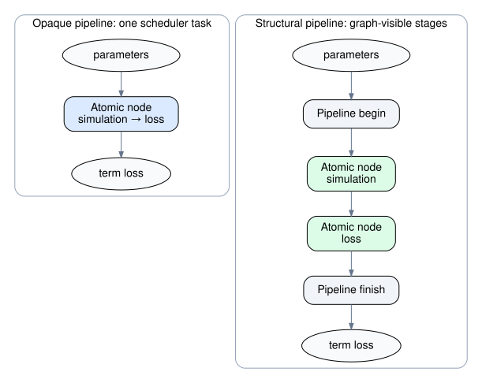
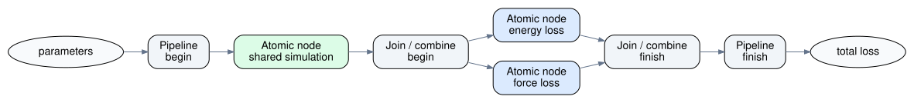

.. _advanced_concepts:

#################
Advanced concepts
#################

The :ref:`component_vocabulary` section defines components, quantity
computers, loss functions, and objectives. This page goes one level deeper: it
explains the common component protocol, the difference between atomic and
structural composition, and the two different kinds of pipeline used by
ChemFit.

These distinctions matter when an objective is executed by a graph scheduler.
Opaque and graph-visible composition can calculate the same value, but they
expose different scheduling boundaries.

-------------------------

The general component abstraction
=================================

:class:`~chemfit.abstract_objective_function.Component` is the
general abstraction behind quantities, losses, objective terms, pipelines,
and joins. Conceptually, a ``Component[InputT, OutputT]`` maps one
input value to one output value::

    InputT -> Component -> OutputT

The input and output do not have to be parameter mappings and scalar losses.
For example, a component may map parameters to quantities, quantities to a
loss, or one intermediate representation to another. ``QuantityComputer`` is
a typing alias for the first of those cases; it is not a separate runtime base
class. Similarly, only components with a ``parameters -> float`` contract are
objectives in the optimizer-facing sense.

The :func:`chemfit.component()
<chemfit.abstract_objective_function.component>` decorator turns an ordinary
callable into a
:class:`~chemfit.abstract_objective_function.WrappedComponent`:

.. testcode::

    import chemfit

    @chemfit.component()
    def normalize(values):
        scale = max(abs(value) for value in values)
        return [value / scale for value in values]

    print(normalize([1.0, -2.0]))

.. testoutput::
    :hide:

    [0.5, -1.0]

``quantity()`` and ``objective()`` use the same wrapping machinery but express
more specific intent in an objective definition. Custom classes can instead
subclass ``Component`` and implement ``_run(input_, ctx)``; see
:ref:`writing_quantity_computers` for implementation guidance.

The evaluation lifecycle
------------------------

Calling a component runs a lifecycle around ``_run()``:

.. code-block:: text

    reset context state
            |
    apply context configurator
            |
    record ctx.input
            |
    run pre-evaluation hooks
            |
    _run(input, ctx), unless a pre-hook supplied the result
            |
    merge static metadata and record ctx.output
            |
    run post-evaluation hooks
            |
    return the value or raise the recorded exception

An ordinary exception from a pre-hook or ``_run()`` is finalized through the
same end lifecycle as a successful value. Consequently, post-hooks can inspect
the exception in ``ctx.output``. A post-hook may also replace ``ctx.output``;
the value stored there after the hooks is authoritative.

A pre-hook short-circuits ``_run()`` by returning a non-``None`` value. The
component still applies its static metadata and runs its post-hooks. This is
important for structural components: a structural component that is
short-circuited at its own pre-hook never creates or evaluates its children.

Fluent configuration methods such as ``with_meta()``, ``bind()``, and
``with_context_configurator()`` return configured copies. This makes it possible
to derive several component definitions from one base object without sharing
their registration lists or configuration dictionaries accidentally.

-------------------------

Atomic and structural components
================================

The graph scheduler divides components into two categories.

An **atomic component** is any ``Component`` that is not a
:class:`~chemfit.abstract_objective_function.StructuralComponent`. The graph
scheduler treats its complete ``_run()`` as one work item. Atomic does not mean
that the implementation is small or that it makes only one function call. An
atomic component can run a simulation, launch an external program, or call
several other components internally. An
:class:`~chemfit.abstract_objective_function.OpaquePipeline` is the built-in
way to represent an ordered sequence that should remain one atomic task.

A **structural component** publishes its immediate children and their data
flow. The graph scheduler expands that description recursively and schedules
the atomic leaves. The structural component's begin and finish phases preserve
its own hooks, metadata, context, and result-combination policy.

The scheduling boundary is the important difference. An opaque pipeline is
submitted as one atomic node, whereas a structural pipeline exposes its
stages between the parent's begin and finish phases:

   The same simulation-to-loss data flow represented by one opaque task
   (left) and by graph-visible structural stages (right).

For example, an opaque pipeline runs both stages inside one scheduler node,
while still recording both invocations in the context hierarchy:

.. testcode::

    from chemfit.abstract_objective_function import OpaquePipeline

    @chemfit.component()
    def minimum(values):
        return min(values)

    opaque = OpaquePipeline(normalize, minimum)
    opaque_ctx = chemfit.EvaluateContext()
    print(opaque([1.0, -2.0], opaque_ctx))
    print([child.output for child in opaque_ctx.children])

.. testoutput::
    :hide:

    -1.0
    [[0.5, -1.0], -1.0]

Calling a component directly from another component's ``_run()`` has the same
opaque scheduling boundary, but is mainly useful for custom atomic control
flow that is not a simple pipeline. For ordinary ordered composition, prefer
``OpaquePipeline``. Calling ``with_loss()`` on an atomic component constructs
one automatically. Use a structural component when its children should be
visible as independent graph nodes.

-------------------------

Two kinds of pipeline
=====================

ChemFit provides both an opaque pipeline and a structural pipeline. Both pass
the output of one stage to the next, but the scheduler sees them differently.

.. list-table:: Opaque and structural pipelines
   :header-rows: 1
   :widths: 22 39 39

   * - Property
     - Opaque pipeline
     - Structural pipeline
   * - Type
     - :class:`~chemfit.abstract_objective_function.OpaquePipeline`
     - :class:`~chemfit.abstract_objective_function.PipelineComponent`
   * - Construction
     - Produced by ``atomic_component.with_loss(...)``; extend with
       ``then(...)``
     - Construct with ``chemfit.pipeline(first, second)`` or by calling
       ``with_loss(...)`` on a structural component; extend with ``then(...)``
   * - Scheduler view
     - One atomic work item
     - One graph-visible node per stage, with structural start and finish nodes
   * - Intermediate transfer
     - Passed directly between stages in the same atomic call
     - Passed as the outcome of one scheduled node to the next
   * - Stage contexts
     - Stored in ``ctx.children``
     - Stored in ``ctx.children``
   * - Failure propagation
     - A raised stage exception immediately prevents later calls
     - Later stages are marked skipped by the default input policy
   * - Typical use
     - Keep a tightly coupled or cheap sequence in one scheduling unit
     - Expose a sequence, including nested structures, to the graph scheduler

Opaque pipelines
----------------

:meth:`~chemfit.abstract_objective_function.Component.with_loss`
constructs an opaque pipeline when the receiver is an ordinary, non-structural
component. The pipeline contains the quantity component and a wrapped loss
component:

.. testcode::

    @chemfit.quantity()
    def simulate(params):
        return {"prediction": params["x"] ** 2}

    def loss(quantities, target):
        return (quantities["prediction"] - target) ** 2

    term = simulate.with_loss(loss, target=2.0)

The graph scheduler submits ``term`` as a single atomic node. The simulation's
result passes directly to the loss without becoming a scheduler-level result.
This avoids an extra scheduling boundary and keeps the usually cheap loss next
to the quantity computation that produced its input.

.. important::

    ``with_loss()`` preserves an existing structural boundary. When called on
    a :class:`~chemfit.abstract_objective_function.StructuralComponent`, it
    returns a :class:`~chemfit.abstract_objective_function.PipelineComponent`
    connecting that structure to the wrapped loss. The scheduler can still
    expand the original descendants:

    .. testcode::

        @chemfit.component()
        def pass_quantities(quantities):
            return quantities

        simulation_graph = chemfit.pipeline(
            simulate,
            pass_quantities,
        )
        visible_term = simulation_graph.with_loss(loss, target=2.0)

        print(visible_term({"x": 3.0}))

    .. testoutput::
        :hide:

        49.0

    Calling ``with_loss()`` on the atomic ``simulate`` component still returns
    an :class:`~chemfit.abstract_objective_function.OpaquePipeline`, keeping
    the quantity calculation and its usually cheap loss in one backend task.

Opaque does not mean unobservable. Each stage receives its own context, in
execution order, and the outer context records those contexts in
``ctx.children``:

.. testcode::

    ctx = chemfit.EvaluateContext()
    value = term({"x": 3.0}, ctx)

    quantity_ctx = ctx.children[0]
    loss_ctx = ctx.children[1]

    assert quantity_ctx.output == {"prediction": 9.0}
    assert loss_ctx.output == value

    print(value)
    print(quantity_ctx.output)
    print(loss_ctx.output)

.. testoutput::
    :hide:

    49.0
    {'prediction': 9.0}
    49.0

The stage contexts are ordinary evaluation children even though the stages are
not separate scheduler nodes. Recursive hook registration still does not
descend through an opaque pipeline because hook traversal follows the
component structure, not the runtime context tree. Register a hook or metadata
on a stage before constructing the pipeline when it belongs to that stage.

If a stage raises, its context records the exception and the normal Python call
chain stops before the next stage. The outer opaque-pipeline context then
records and re-raises the same failure through its own end lifecycle.

Structural pipelines
--------------------

:func:`chemfit.pipeline() <chemfit.api.pipeline>` constructs a
:class:`~chemfit.abstract_objective_function.PipelineComponent` that declares
the same left-to-right data flow structurally:

.. testcode::

    @chemfit.component()
    def double(value):
        return 2 * value

    @chemfit.component()
    def add_one(value):
        return value + 1

    pipeline = chemfit.pipeline(double, add_one).then(double)

    print(pipeline(3))

.. testoutput::
    :hide:

    14

The first stage receives the pipeline's parent input. Every later stage depends
on its immediate predecessor and receives that predecessor's outcome. The
final stage supplies the pipeline result.

Stages within this simple chain cannot run concurrently, but graph visibility
still matters. A stage can itself be a join with parallel children; schedulers
can place each atomic stage separately; and failures become explicit skipped
outcomes for downstream nodes. If the final stage was skipped because an
upstream stage failed, the pipeline re-raises the original failure. An
intentional final skip without a failure reason raises ``RuntimeError`` because
the pipeline has no value to return.

-------------------------

.. _combine_or_join:

Joins and independent children
==============================

A join describes a fan-out/fan-in shape:

.. code-block:: text

                      +--> child 0 --+
    parent input -----+--> child 1 --+--> combine outcomes
                      +--> child 2 --+

:class:`~chemfit.abstract_objective_function.JoinedComponent` is the base
implementation for that shape. Every child receives the original parent input,
and the children have no dependencies on one another. Direct evaluation visits
them sequentially; a graph scheduler may run them concurrently.

:func:`chemfit.join() <chemfit.api.join>` constructs the general built-in join
and returns its child outcomes as a tuple:

.. testcode::

    @chemfit.component()
    def square(value):
        return value**2

    @chemfit.component()
    def cube(value):
        return value**3

    joined = chemfit.join(square, cube)
    joined_ctx = chemfit.EvaluateContext()

    print(joined(3, joined_ctx))
    print([child.output for child in joined_ctx.children])

.. testoutput::
    :hide:

    (9, 27)
    [9, 27]

:class:`~chemfit.abstract_objective_function.JoinedComponent` leaves
:meth:`~chemfit.abstract_objective_function.JoinedComponent.combine_outcomes`
to subclasses. The built-in
:class:`~chemfit.abstract_objective_function.TupleJoinedComponent` returns the
child outcomes in declaration order, preserving exceptions and skip markers as
tuple entries.

A component after :func:`chemfit.join() <chemfit.api.join>` therefore owns the
result policy. It can re-raise a child exception, replace it with a penalty,
omit that result, or preserve it for reporting. This is useful when the
branches are not all scalar losses or when fitting-specific exception handlers
do not express the required policy. ChemFit exposes the outcomes; the
downstream component must implement the chosen interpretation explicitly.

:class:`~chemfit.combined_objective_function.CombinedObjectiveFunction`,
constructed by :func:`chemfit.combine() <chemfit.api.combine>`, is a
specialized join of scalar-valued objective terms. It has the same independent
child structure as :func:`chemfit.join() <chemfit.api.join>`, but adds weights,
a scalar reduction, and a built-in exception policy. Once all terms have
completed, it:

1. passes failed term outcomes to the configured exception handler;
2. omits terms for which that handler returns ``None``;
3. multiplies the remaining values by their weights; and
4. passes the weighted values to the configured reducer.

The default exception handler re-raises a term failure during the combine
phase. Importantly, the failure is first captured as that child's outcome, so
independent siblings can still complete. Alternative handlers may replace a
failure with ``NaN`` or omit the failed term. The indices of omitted terms are
recorded in the combined context's ``meta["skipped_indices"]``.

-------------------------

Composing pipelines and joins
=============================

Structural components can be nested. A useful fitting pattern is to run one
expensive simulation, pass its quantities to several independent loss
components, and then reduce those losses. This avoids repeating the simulation
for every observable while keeping the loss branches visible to the scheduler:

   A pipeline containing a join. The shared simulation runs once; the energy
   and force losses can then be evaluated independently.

The general :func:`chemfit.join() <chemfit.api.join>` form returns the branch
outcomes as a tuple, so a later pipeline stage decides how to interpret them:

.. testcode::

    @chemfit.component()
    def simulate_pair(params):
        epsilon = params["epsilon"]
        return {"energy": -2.0 * epsilon, "forces": [epsilon, 0.0]}

    @chemfit.objective()
    def energy_loss(quantities):
        return (quantities["energy"] - (-1.5)) ** 2

    @chemfit.objective()
    def force_loss(quantities):
        reference = [0.8, 0.0]
        return sum(
            (predicted - expected) ** 2
            for predicted, expected in zip(quantities["forces"], reference)
        )

    @chemfit.component()
    def sum_losses(losses):
        return sum(losses)

    joined_losses = chemfit.join(energy_loss, force_loss)
    joined_objective = chemfit.pipeline(
        simulate_pair,
        joined_losses,
    ).then(sum_losses)

    print(round(joined_objective({"epsilon": 1.0}), 2))

.. testoutput::
    :hide:

    0.29

Because :func:`chemfit.combine() <chemfit.api.combine>` is the specialized join
for scalar objective terms, it can occupy the same pipeline position and apply
weights, exception handling, and reduction directly:

.. testcode::

    combined_losses = chemfit.combine(
        energy_loss,
        force_loss,
        weights=[1.0, 1.0],
    )
    combined_objective = chemfit.pipeline(simulate_pair, combined_losses)

    print(round(combined_objective({"epsilon": 1.0}), 2))

.. testoutput::
    :hide:

    0.29

Use ``pipeline(simulation, combine(...))`` when the branches are scalar fitting
terms with one final loss. Use ``pipeline(simulation, join(...)).then(...)``
when the branch outputs are non-scalar or require a custom downstream stage.

-------------------------

.. _custom_component_graphs:

Custom component graphs
=======================

:func:`chemfit.graph() <chemfit.api.graph>` builds a
:class:`~chemfit.graph_component.GraphComponent` for data flow that is more
general than a pipeline or join. The builder is deliberately small:

- ``builder.input`` refers to the completed graph's parent input;
- ``builder.call(component, *inputs)`` adds a node and returns a
  :class:`~chemfit.graph_component.NodeRef` to its result;
- ``builder.depends_on(node, *dependencies)`` adds ordering without passing
  data; and
- ``builder.output(*sources)`` snapshots the graph and selects its result.

Nodes must be added in topological order. A node reference may be used only
with the builder that created it. Passing one reference to several calls shares
that result: the referenced component is evaluated once, after which each
consumer receives its outcome.

.. testcode::

    @chemfit.component()
    def simulate(params):
        return {
            "energy": -params["scale"],
            "force": 2 * params["scale"],
        }

    @chemfit.component()
    def energy_error(quantities):
        return abs(quantities["energy"] + 1.0)

    @chemfit.component()
    def force_error(quantities):
        return abs(quantities["force"] - 1.5)

    builder = chemfit.graph()
    quantities = builder.call(simulate, builder.input)
    energy = builder.call(energy_error, quantities)
    force = builder.call(force_error, quantities)
    errors = builder.output(energy, force)

    print(errors({"scale": 1.0}))

.. testoutput::
    :hide:

    (0.0, 0.5)

One input is passed directly to a node. Multiple inputs are grouped into a
tuple in their declared order. Those data references also imply execution
dependencies. In contrast, ``depends_on()`` only delays a node; it does not
change the values passed to that node. This is useful when two operations share
the graph input but one must wait for the other's side effect.

``output()`` requires at least one source. A sole output is returned directly;
multiple outputs are returned as a tuple. For one output, an exception is
raised and a skip caused by an upstream exception re-raises that cause. In a
multiple-output tuple, exception and
:class:`~chemfit.abstract_objective_function.Skipped` outcomes are preserved as
entries, matching join semantics.

Any component may be a graph node, including another graph, pipeline, join, or
combined objective. Direct evaluation follows the reference structural
semantics, while serial, executor, and MPI graph schedulers may overlap nodes
whose dependencies are satisfied. Calling ``output()`` takes a topology
snapshot, so extending the builder afterward does not modify components that
were already created.

-------------------------

The structural component contract
=================================

A custom :class:`~chemfit.abstract_objective_function.StructuralComponent`
describes one level of composition with six methods:

``components()``
    Returns the immediate children in topological order. The position of each
    child is its index in all other declarations.

``component_dependencies()``
    Returns one tuple of prerequisite child indices per child. Dependencies
    constrain readiness but do not supply the child's input value.

``component_inputs()``
    Returns the ordered input sources for every child. An integer source also
    creates the required graph dependency because the referenced result must
    exist before it can be consumed.

``resolve_child_input(index, inputs, ctx)``
    Converts the assembled sources into the actual child input or returns a
    :class:`~chemfit.abstract_objective_function.Skipped` marker. The default
    returns a sole source directly, groups multiple sources in a tuple, and
    skips when any source is an exception or is already skipped.

``combine_inputs()``
    Selects the sources passed to ``combine_outcomes()``. The default selects
    every immediate child outcome in component order.

``combine_outcomes(outcomes, ctx)``
    Interprets the selected values, exceptions, and skip markers and produces
    the structural component's result.

An input source can be:

``PARENT_INPUT``
    The input received by the structural component.

An integer
    The outcome of the child at that index. The child must precede its consumer
    in topological order.

A :class:`~chemfit.abstract_objective_function.Skipped` value
    An explicit instruction to skip. ``SKIPPED`` is the shared marker without
    a reason; ``Skipped(reason=exception)`` retains a causal failure.

Dependencies and inputs answer different questions. For example, a child may
need another child to finish before it starts but still receive the original
parent input. That relationship belongs in ``component_dependencies()``. If it
consumes the other child's value, that relationship belongs in
``component_inputs()`` and also implies execution ordering.

The reference ``StructuralComponent._run()`` evaluates this description
sequentially. Graph schedulers compile the same description and may overlap
independent children. Both paths must produce the same values, skips,
exceptions, hooks, and context state. The sequential implementation is
therefore also the semantic reference for a custom structure.

Selecting only some results in ``combine_inputs()`` does not let the parent
finish early. The structural scope waits for every immediate child to finish
or be skipped before it runs ``combine_outcomes()`` and its post-hooks. This
ensures that all child side effects and context results are complete when the
parent lifecycle ends.

The complete implementation pattern, including a custom two-way structure,
is covered in :ref:`writing_quantity_computers`.

-------------------------

Context hierarchy
=================

The context tree records evaluation scopes identically for both composition
models:

.. code-block:: text

    structural join                 opaque pipeline

    parent_ctx                      outer_ctx
    ├── child_ctx_0                 ├── stage_ctx_0
    └── child_ctx_1                 └── stage_ctx_1

In both cases, ``ctx.children`` contains one context per immediate invocation
in declaration order. Nested compositions create nested context trees
recursively. Contexts have no parent or reverse-dependency links, and sibling
dataflow dependencies are represented only by the compiled call graph.
:meth:`~chemfit.evaluate_context.EvaluateContext.to_summary` follows the
``children`` hierarchy when called with ``recursive=True``.

Each structural context records its immediate declared structure in
``ctx.meta["chemfit.structure"]``. Its child indices correspond to
``ctx.children``; nested structural contexts carry their own descriptions.
This supports recursive reconstruction without storing a flattened
description. See :ref:`evaluation_contexts` for the metadata schema and an
inspection example.

Child contexts are created only after the structural parent's begin lifecycle
succeeds. If a parent pre-hook returns a result or raises, it has no child
contexts, although its structural metadata still declares them. A structural
child skipped by input resolution retains its local description but has
``NO_OUTPUT`` and no children. A child that executes and fails instead stores
the exception in ``ctx.output``. ChemFit does not create deeper contexts below
a structural scope that never starts.

Each child gets a deep copy of its parent's ``config``, a fresh ``meta`` and
``temp``, and the same ``shared`` namespace for local execution. Worker-backed
schedulers transport result-bearing input, output, metadata, and nested child
state back to the coordinator; temporary state and worker mutations to
``shared`` are not result channels.

-------------------------

Choosing the right composition
==============================

Use the smallest abstraction that expresses the scheduling boundary you need:

- Wrap one callable with ``component()``, ``quantity()``, or ``objective()``
  when it is one logical work item.
- Use an :class:`~chemfit.abstract_objective_function.OpaquePipeline` when an
  ordered sequence must stay inside one atomic scheduler task. Calling
  ``with_loss()`` on an atomic component creates this form automatically.
- Call nested components directly from ``_run()`` only for custom atomic
  control flow that cannot be expressed as an opaque pipeline.
- Use :func:`chemfit.pipeline() <chemfit.api.pipeline>` for an ordered sequence
  whose stages should remain graph-visible.
- Use :func:`chemfit.join() <chemfit.api.join>` for independent fan-out that
  returns every outcome, or
  :class:`~chemfit.combined_objective_function.CombinedObjectiveFunction` for
  independent scalar terms followed by configurable reduction.
- Use :func:`chemfit.graph() <chemfit.api.graph>` for a custom directed acyclic
  graph with shared intermediate results or ordering-only dependencies.
- Implement :class:`~chemfit.abstract_objective_function.StructuralComponent`
  directly for conditional execution or a specialized recovery policy that
  the graph builder does not express.

Once the component structure is clear, :ref:`parallel_execution` explains how
the available graph nodes are mapped to serial, executor, and MPI backends.
