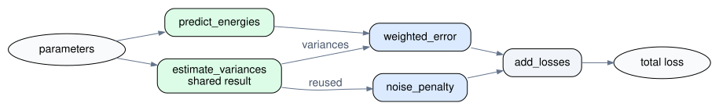

.. _problem_guide:

What do you want to do?
=======================

A parameter fit usually has four parts: an optimizer proposes parameters, a
scientific calculation predicts quantities, a loss compares those quantities
with reference data, and the resulting number goes back to the optimizer.
ChemFit helps connect those parts without requiring the simulation code to
know anything about optimization or parallel execution.

ChemFit calls each reusable calculation a *component*. A component can run a
simulation, calculate a loss, or connect several other components. Start with
the simplest arrangement that matches the science; introduce pipelines,
branches, or graphs only when the calculation actually has those shapes. This
guide explains those choices. The linked pages contain the complete API and
more detailed examples.

Building the fitting objective
------------------------------

How do I fit one calculated quantity to reference data?
~~~~~~~~~~~~~~~~~~~~~~~~~~~~~~~~~~~~~~~~~~~~~~~~~~~~~~~

Begin by wrapping the function that performs the scientific calculation. Its
input is normally a dictionary of parameters, and its output is whatever data
the loss needs. Then attach a loss function with
:meth:`~chemfit.abstract_objective_function.Component.with_loss`:

.. testcode::

   import chemfit

   @chemfit.quantity()
   def simulate(params, *, distance):
       ratio = params["sigma"] / distance
       energy = 4.0 * params["epsilon"] * (ratio**12 - ratio**6)
       return {"energy": energy}

   def squared_error(quantities, *, reference):
       return (quantities["energy"] - reference) ** 2

   energy_term = simulate.bind(distance=1.1).with_loss(
       squared_error,
       reference=-0.98,
   )

   print(round(energy_term({"epsilon": 0.7, "sigma": 1.0}), 4))

.. testoutput::
   :hide:

   0.0851

Here ``simulate`` remains a calculation of physical quantities. The new
``energy_term`` is the scalar objective term that an optimizer can minimize.
Keeping the two functions separate makes it easy to change the reference or
loss without rewriting the simulation. If an existing function already
returns the final scalar loss, wrap it with :func:`chemfit.objective()
<chemfit.abstract_objective_function.objective>` instead.

:meth:`~chemfit.abstract_objective_function.Component.with_loss` is
the right default for one calculation followed by one comparison. It keeps the
usually cheap loss beside its calculation as one scheduler task. Use explicit
composition only when an intermediate result must be reused or when its stages
need to be visible separately to the scheduler. See :ref:`common_workflows`
for the complete wrap--compare--fit workflow and
:ref:`writing_quantity_computers` for calculation interfaces.

How do I fit several observables or datasets?
~~~~~~~~~~~~~~~~~~~~~~~~~~~~~~~~~~~~~~~~~~~~~~

Make one scalar term for each meaningful comparison, then use
:func:`chemfit.combine() <chemfit.api.combine>` to obtain the total objective.
For example, the same potential can be compared with reference energies at
two separations:

.. testcode::

   near = simulate.bind(distance=1.1).with_loss(
       squared_error, reference=-0.98
   )
   far = simulate.bind(distance=1.5).with_loss(
       squared_error, reference=-0.32
   )
   objective = chemfit.combine(near, far, weights=[1.0, 0.25])

   print(round(objective({"epsilon": 0.7, "sigma": 1.0}), 4))

.. testoutput::
   :hide:

   0.0873

The two terms receive the same proposed parameters. They are independent, so
a concurrent scheduler may run them at the same time. Weights can account for
different units, uncertainty, dataset size, or scientific priority; they
should not be chosen merely to make numbers look similar. If a weighted sum
is not the desired objective, :func:`chemfit.combine() <chemfit.api.combine>`
also accepts a custom reduction. The exact weighting and reduction rules are in
:ref:`combined_objective_functions`.

:func:`chemfit.combine() <chemfit.api.combine>` is a specialized join of
scalar-valued components. It has the same independent fan-out as
:func:`chemfit.join() <chemfit.api.join>`, with weights, scalar reduction, and
exception-handling policy added for fitting objectives. Use
:func:`chemfit.combine() <chemfit.api.combine>` when the branches are losses
that should become one number.

Use :func:`chemfit.join() <chemfit.api.join>` when the branch outputs should
remain separate. It returns a tuple containing their outcomes, and a later
component can decide how to interpret both successful results and failures.
This allows application code to implement its own exception policy when the
policies built into :func:`chemfit.combine() <chemfit.api.combine>` are not
suitable. The shared structure and different result policies are detailed in
:ref:`combine_or_join`. This distinction also matters when sharing a
simulation, discussed below.

How should I constrain the parameters?
~~~~~~~~~~~~~~~~~~~~~~~~~~~~~~~~~~~~~~~

For ordinary numeric limits, pass a ``bounds`` dictionary with the same shape
as the initial parameters. Nevergrad users can pass an explicit
``parametrization`` for choices, logarithmic scales, arrays, or constants.
ChemFit does not infer physical relationships between parameters. A coupled
constraint such as ``inner_radius < outer_radius`` must be represented in the
optimizer, built into the parametrization, or checked before launching an
expensive calculation. An objective pre-hook can reject such a proposal with
a penalty. See :ref:`fitter` for parameter spaces and :ref:`objective_hooks`
for early validation.

Connecting a scientific calculation
------------------------------------

How do I use existing Python, ASE, or an external program?
~~~~~~~~~~~~~~~~~~~~~~~~~~~~~~~~~~~~~~~~~~~~~~~~~~~~~~~~~~

For Python code, choose the wrapper by what the function returns:

* :func:`chemfit.quantity() <chemfit.abstract_objective_function.quantity>`
  for predictions that will later be compared with data;
* :func:`chemfit.objective() <chemfit.abstract_objective_function.objective>`
  for an already complete scalar loss; and
* :func:`chemfit.component() <chemfit.abstract_objective_function.component>`
  for another transformation, such as extracting features or combining
  results.

These wrappers add ChemFit's evaluation lifecycle without changing the
scientific function.
:meth:`~chemfit.abstract_objective_function.WrappedComponent.bind` supplies
fixed conditions such as temperature, structure, or dataset name, as in the
first example. See :ref:`public_api` for the wrappers and
:ref:`component_vocabulary` for their roles.

If ASE already represents the structure and calculator, begin with
:func:`chemfit.ase_quantity() <chemfit.api.ase_quantity>`. A typical setup has
this shape:

.. code-block:: python

   energy_term = (
       chemfit.ase_quantity("structure.xyz")
       .with_calculator(make_calculator)
       .with_processor(read_energy)
       .with_loss(energy_loss, target=-12.4)
   )

Configure the calculator with
:meth:`~chemfit.ase_objective_function.ASEComputer.with_calculator`, extract
quantities with
:meth:`~chemfit.ase_objective_function.ASEComputer.with_processor`, and attach
the loss with
:meth:`~chemfit.abstract_objective_function.Component.with_loss`.
By default this performs a single-point calculation. Add
:meth:`~chemfit.ase_objective_function.ASEComputer.minimize` when the geometry
itself should be optimized before quantities are extracted, or
:meth:`~chemfit.ase_objective_function.ASEComputer.with_evaluator` for a custom
ASE procedure. Those choices change the scientific meaning and cost of every
evaluation, so they should be explicit. See
:ref:`ase_objective_function_api` for the stage lifecycle.

For a command-line simulation, use :func:`chemfit.external_quantity()
<chemfit.api.external_quantity>` to describe the working directory, input
hook, command, completion file, and parser:

.. code-block:: python

   density_term = (
       chemfit.external_quantity("runs")
       .with_hook(write_input, template="input.template")
       .with_cmd(run_model, executable="my-model")
       .with_parser(parse_output, "results.json")
       .wait_for("task.done")
       .with_loss(density_loss, target=0.997)
   )

The named callables are application code: ChemFit arranges when and where they
run. :meth:`~chemfit.external_computer.ExternalQuantityComputer.with_hook` and
:meth:`~chemfit.external_computer.ExternalQuantityComputer.with_cmd` add
execution steps;
:meth:`~chemfit.external_computer.ExternalQuantityComputer.with_parser` and
:meth:`~chemfit.external_computer.ExternalQuantityComputer.wait_for` declare
the required outputs. It does not submit cluster jobs, choose resources, or
retry failed programs. See :ref:`external_computer` for paths, timeouts,
parsing, and retaining failed working directories.

Avoiding unnecessary computation
---------------------------------

How do I calculate an expensive intermediate result only once?
~~~~~~~~~~~~~~~~~~~~~~~~~~~~~~~~~~~~~~~~~~~~~~~~~~~~~~~~~~~~~~~

Suppose one simulation produces both an energy and forces. Building two
separate terms with
:meth:`~chemfit.abstract_objective_function.Component.with_loss`
would run that simulation twice. Instead, run it once, then branch into two
loss components. Because the branch outputs are scalar losses,
:func:`chemfit.combine() <chemfit.api.combine>` is the appropriate branch:

.. testcode::

   @chemfit.component()
   def simulate_pair(params):
       epsilon = params["epsilon"]
       return {"energy": -2.0 * epsilon, "forces": [epsilon, 0.0]}

   @chemfit.objective()
   def energy_loss(quantities):
       return (quantities["energy"] + 1.5) ** 2

   @chemfit.objective()
   def force_loss(quantities):
       reference = [0.8, 0.0]
       return sum(
           (value - target) ** 2
           for value, target in zip(quantities["forces"], reference)
       )

   shared_objective = chemfit.pipeline(
       simulate_pair,
       chemfit.combine(energy_loss, force_loss),
   )

   print(round(shared_objective({"epsilon": 1.0}), 2))

.. testoutput::
   :hide:

   0.29

.. figure:: ../images/pipeline_join_callgraph.svg
   :alt: Parameters flow through one shared simulation, then branch into energy and force losses before being combined into the total loss.
   :width: 100%
   :align: center

   The pipeline evaluates the shared simulation once. The combined objective
   can then evaluate the energy and force losses independently before reducing
   them to the total loss.

The pipeline first runs ``simulate_pair``. Only after it finishes do the two
loss terms receive its quantities; those losses are mutually independent.
If the branches produced arrays or diagnostic objects instead, use
:func:`chemfit.join() <chemfit.api.join>` and add a later component that turns
its result tuple into the required output. More nesting patterns are shown in
:ref:`advanced_concepts`.

When is a pipeline sufficient, and when do I need a graph?
~~~~~~~~~~~~~~~~~~~~~~~~~~~~~~~~~~~~~~~~~~~~~~~~~~~~~~~~~~~

:func:`chemfit.pipeline() <chemfit.api.pipeline>` represents a straight
sequence: prepare, simulate, post-process, score. A
:func:`chemfit.join() <chemfit.api.join>` or
:func:`chemfit.combine() <chemfit.api.combine>` represents branches that all
receive the same input. These forms are easier to read than a graph and cover
most fitting problems.

Use :func:`chemfit.graph() <chemfit.api.graph>` when the dataflow genuinely
branches and reconnects in less regular ways, or when several downstream
steps need the same intermediate result. Node references describe where data
comes from:

.. testcode::

   @chemfit.component()
   def predict_energies(params):
       scale = params["scale"]
       return [1.0 * scale, 2.0 * scale]

   @chemfit.component()
   def estimate_variances(params):
       variance = params["noise"] ** 2
       return [variance, variance]

   @chemfit.component()
   def weighted_error(inputs):
       predictions, variances = inputs
       reference = [1.1, 1.9]
       return sum(
           (value - target) ** 2 / variance
           for value, target, variance in zip(
               predictions, reference, variances
           )
       )

   @chemfit.component()
   def noise_penalty(variances):
       return 0.1 * sum(variances)

   @chemfit.component()
   def add_losses(losses):
       return sum(losses)

   builder = chemfit.graph()
   predictions = builder.call(predict_energies, builder.input)
   variances = builder.call(estimate_variances, builder.input)
   misfit = builder.call(weighted_error, predictions, variances)
   penalty = builder.call(noise_penalty, variances)
   total = builder.call(add_losses, misfit, penalty)
   objective = builder.output(total)

   print(round(objective({"scale": 1.0, "noise": 0.5}), 2))

.. testoutput::
   :hide:

   0.13

   The prediction and uncertainty model can run independently. The variance
   estimate is then shared by the data-misfit and regularization paths before
   those paths merge into the total loss.

Here the branches do not all receive the same value: ``weighted_error`` needs
both predictions and variances, ``noise_penalty`` needs only the variances,
and ``add_losses`` needs the two resulting losses. This can be forced into
nested pipelines and joins by forwarding and unpacking tuples, but a graph
states the actual data routing directly. The variance calculation is evaluated
once even though two nodes consume it.
:meth:`~chemfit.graph_component.GraphBuilder.call` creates each node, and
:meth:`~chemfit.graph_component.GraphBuilder.output` selects the graph result.
A graph may also declare an ordering-only dependency with
:meth:`~chemfit.graph_component.GraphBuilder.depends_on`; use that when an
operation must wait for a side effect but does not consume the earlier result.
A graph shares results only within one evaluation. Reuse across different
parameter candidates requires a correct application-level cache. Graph
construction, outputs, and nested components are documented in
:ref:`custom_component_graphs`.

Scaling expensive evaluations
-----------------------------

How do I run more than one calculation at a time?
~~~~~~~~~~~~~~~~~~~~~~~~~~~~~~~~~~~~~~~~~~~~~~~~~~

There are two places for concurrency. An optimizer can propose a batch of
parameter candidates, and independent branches inside each candidate can run
concurrently. The convenient fitting interface exposes both controls:

.. code-block:: python

   result = chemfit.fit_nevergrad(
       objective,
       initial={"epsilon": 0.7, "sigma": 1.0},
       bounds={"epsilon": (0.1, 2.0), "sigma": (0.5, 2.0)},
       optimizer="NgIohTuned",
       budget=100,
       batch_size=4,
       execution_workers=8,
   )

``batch_size`` controls how many candidates Nevergrad asks for together.
``execution_workers`` controls how many runnable component tasks the built-in
thread scheduler may execute at once across that batch. Increasing either
number can also increase memory use or the number of external simulations.
Measure a representative evaluation before choosing large values. See
:ref:`parallel_execution` for executor ownership and lower-level scheduling.

Which should I use: threads, processes, or MPI?
~~~~~~~~~~~~~~~~~~~~~~~~~~~~~~~~~~~~~~~~~~~~~~~~

Start with threads for external programs, file or network I/O, and numerical
libraries that release Python's GIL. They have low overhead and do not require
copying the objective into another process. Use a process executor for
CPU-bound Python when the GIL prevents useful thread concurrency; components,
parameters, hooks, and worker context state must then be serializable, and
large results add transfer cost.

Use MPI when the application is already launched across MPI ranks or must
span several nodes. Every rank constructs the same objective; rank zero
coordinates, while other ranks enter ChemFit's worker loop. MPI is therefore
an execution decision, not a different scientific model. ChemFit does not
provision nodes or place work according to memory, GPU, or estimated runtime.
The required launch and shutdown pattern is in :ref:`mpi`.

Handling failures and understanding evaluations
-----------------------------------------------

What is an evaluation context, and when do I need one?
~~~~~~~~~~~~~~~~~~~~~~~~~~~~~~~~~~~~~~~~~~~~~~~~~~~~~~~

An :class:`~chemfit.evaluate_context.EvaluateContext` is the record of one
component evaluation. It is not another scientific input and does not carry
data from one component to the next. ChemFit uses it to record the component's
input, its final output (or exception), and diagnostic metadata produced while
the call runs. This keeps per-call state out of reusable component objects,
which is important when several evaluations run concurrently.

ChemFit creates a context automatically when you call a component, so most
users do not need to manage one. Pass your own context when directly calling a
component if you want to inspect the completed record. During fitting, ChemFit
maintains one context per candidate slot. Each context is reused and records
the slot's current and best evaluation state; it is not a history of every
candidate evaluated. The high-level
:func:`chemfit.fit_nevergrad() <chemfit.api.fit_nevergrad>` helper returns these
contexts with its :class:`~chemfit.api.FitResult`.

Structural components produce a hierarchy of records: the outer context
describes the pipeline, join, combined objective, or graph as a whole, and its
``children`` contain the contexts of the components inside it. This hierarchy
answers questions such as which term failed and what a simulation returned.
It describes the nested evaluation, not the computational dependency graph;
dependencies are defined by the components themselves. Hooks receive the
context for the component they surround and can add information such as
timings or convergence details to ``meta``. See :ref:`evaluation_contexts` and
:ref:`objective_hooks` for the complete lifecycle and advanced context fields.

What should happen when a simulation fails?
~~~~~~~~~~~~~~~~~~~~~~~~~~~~~~~~~~~~~~~~~~~~~

Choose the policy according to what the missing result means scientifically.
By default, a failed term is re-raised. If other objective terms remain valid,
a combined objective can use
:meth:`~chemfit.combined_objective_function.CombinedObjectiveFunction.with_exception_handler`
to turn the failed term into ``NaN`` or omit it. Passing an explicit context
in this direct call lets us inspect which term was omitted with
:func:`~chemfit.combined_objective_function.skip_exception_handler`:

.. testcode::

   def valid_term(params):
       return 2.0

   def failed_term(params):
       raise RuntimeError("simulation did not converge")

   tolerant = chemfit.combine(valid_term, failed_term).with_exception_handler(
       chemfit.skip_exception_handler
   )
   failure_ctx = chemfit.EvaluateContext()

   print(tolerant({}, failure_ctx))
   print(failure_ctx.meta["skipped_indices"])

.. testoutput::
   :hide:

   2.0
   [1]

Skipping changes the objective because fewer observations contribute; do it
only when that interpretation is defensible. If the whole parameter candidate
is invalid, let the failure reach the fitter or return a non-finite loss. A
direct :class:`~chemfit.fitter.Fitter` can replace ordinary exceptions with
``value_bad_params`` when ``swallow_exceptions=True``. ChemFit does not
automatically retry or recover interrupted simulations. See
:ref:`combined_objective_functions` for term policies and :ref:`fitter` for
candidate-level handling.

Choosing an optimization interface
----------------------------------

Should I use :func:`chemfit.fit_nevergrad() <chemfit.api.fit_nevergrad>` or :class:`~chemfit.fitter.Fitter` directly?
~~~~~~~~~~~~~~~~~~~~~~~~~~~~~~~~~~~~~~~~~~~~~~~~~~~~~~~~~~~~~~~~~~~~~~~~~~~~~~~~~~~~~~~~~~~~~~~~~~~~~~~~~~~~~~~~~~~~~~

Use :func:`chemfit.fit_nevergrad() <chemfit.api.fit_nevergrad>` for an ordinary
bounded derivative-free fit. It configures the scheduler and fitter and
returns a result containing the recommendation, best observed parameters and
loss, and one fitting context per candidate slot. The earlier concurrency
example is the usual starting point.

Use :class:`~chemfit.fitter.Fitter` directly when you need SciPy, exception
swallowing, supplied contexts, a prepared schedule that your application owns,
or a custom optimizer. Its :meth:`~chemfit.fitter.Fitter.init`,
:meth:`~chemfit.fitter.Fitter.evaluate`, :meth:`~chemfit.fitter.Fitter.step`,
and :meth:`~chemfit.fitter.Fitter.finish` lifecycle lets an external optimizer
propose candidates while ChemFit still records and schedules their evaluations.
Fitter callbacks are the right place for progress logging and saving best
parameters; component hooks observe individual scientific calculations.
Previous observations can seed a Nevergrad run, but they do not restore the
optimizer's internal state. See :ref:`fitter` for both interfaces and callback
examples.

Extending ChemFit
-----------------

When should I write a custom component or scheduler?
~~~~~~~~~~~~~~~~~~~~~~~~~~~~~~~~~~~~~~~~~~~~~~~~~~~~~

Prefer the function wrappers until a calculation needs reusable configuration,
a specialized evaluation method, or a custom copy policy. Then subclass
:class:`~chemfit.abstract_objective_function.Component` and implement
its calculation. Keep mutable per-evaluation state in the context rather than
on the component, because the same component may be evaluated concurrently.

Most computation structures should use the built-in
:func:`chemfit.pipeline() <chemfit.api.pipeline>`,
:func:`chemfit.join() <chemfit.api.join>`,
:func:`chemfit.combine() <chemfit.api.combine>`, or
:func:`chemfit.graph() <chemfit.api.graph>`. Write a custom
:class:`~chemfit.abstract_objective_function.StructuralComponent` only when
those cannot express the execution policy—for example, genuinely conditional
child execution. Write a custom :class:`~chemfit.scheduling.Scheduler` only
when the execution backend itself must change. Persistence, automatic
recovery, cluster job management, and resource-aware scheduling are not built
in; an application or external workflow system must provide them. The
component contract is documented in :ref:`writing_quantity_computers`, and
the structural and scheduling contracts in :ref:`advanced_concepts`.
